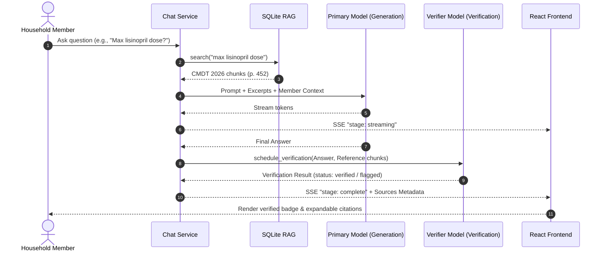

# CMDT 2026 Local RAG Grounding: Detailed Engineering Plan

Related docs: [[PLAN]] | [[rag-cmdt-tasklist]] | [[Modification-plan]] | [[TASKLIST]]

---

## 1. Executive Summary & 3C Protocol

### Compress
Equip the Health Manager Chat assistant with real-time, deterministic clinical grounding over *CURRENT Medical Diagnosis & Treatment 2026* (1,967 pages) using local SQLite FTS5 (BM25 ranking), preserving strict patient privacy and enforcing prompt-only excerpt injection with client metadata citations.

### Compile
| Dimension | Specification | Rationale |
| :--- | :--- | :--- |
| **Reference Target** | `/home/em/nas/EBOOKS/BOOK COLLECTIONS/Sorted/Fav Books/CURRENT Medical Diagnosis & Treatment-2026.pdf` | Authoritative 2026 ambulatory & inpatient diagnostic manual (102 MB, 1,967 pp). |
| **Storage Engine** | SQLite 3 FTS5 Virtual Table (`chunks`) | Zero external vector DB dependencies; ~150 MB disk footprint; sub-5ms BM25 latency. |
| **Tokenization & Chunking** | 2,000 chars/chunk + 200 chars sliding overlap | Page-anchored; protects clinical dosage formulas and multi-sentence diagnostic criteria. |
| **Search Sanitization** | Alphanumeric filter + English stopword removal + FTS5 `OR` join | Prevents query dilution from conversational fillers ("what is the treatment for..."); protects against FTS5 syntax injection. |
| **API Contract** | Server-Sent Events (SSE) `/api/v1/conversations/{id}/messages/stream` | Real-time token streaming (`stage: "streaming"`) with final citation payload (`stage: "complete"`). |
| **Citation Invariant** | Metadata-only (`source`, `page`, `record_id`, `snippet`) | Copyrighted reference prose stays within server memory/prompts and is never distributed. |
| **Verification Gate** | Two-pass asynchronous review (`schedule_verification`) | Secondary LLM pass audits claims and dosage accuracy against retrieved reference chunks. |
| **UI Presentation** | React 19 + Lucide (`BookOpen`) pill dropdown | Displays interactive badge `CMDT 2026 · p. <page>` with expandable audit snippet. |

### Consolidate
The backend contains the foundational scaffolding in [`backend/app/services/rag.py`](file:///home/em/code/health-manager-v2/backend/app/services/rag.py) and [`backend/app/scripts/seed_rag_index.py`](file:///home/em/code/health-manager-v2/backend/app/scripts/seed_rag_index.py). This plan details the exact algorithmic enhancements (overlap, stopword pruning), indexing execution, prompt formatting contracts, verification safety loops, and test acceptance criteria.

---

## 2. System Architecture & Information Flow

```mermaid
flowchart TD
    subgraph Data Ingestion (Offline Pipeline)
        A["CMDT 2026 PDF<br>(1,967 Pages, 102 MB)"] -->|PyMuPDF fitz| B["Page Text Extraction<br>with Progress Ticker"]
        B -->|Sliding Window<br>2000 chars / 200 overlap| C["Chunk Generator<br>(Text, Page, Source)"]
        C -->|Batch INSERT| D[("SQLite FTS5 chunks<br>backend/data/rag-index.sqlite")]
    end

    subgraph Query Execution (Runtime Online Flow)
        E["User Query<br>e.g., 'Metformin dosing in CKD'"] --> F["Query Preprocessor<br>(Stopword Filter + Sanitizer)"]
        F -->|Clean Terms MATCH| D
        D -->|BM25 Ranking top_k=4| G["Retrieved Hits<br>(Text, Page, Source, Rank)"]
        G --> H["Prompt Assembler<br>(rag.grounding_block)"]
        I["Member Health Profile<br>(Vitals, Labs, Meds, Allergies)"] --> H
        H --> J["Grounded Prompt Block"]
        J --> K["Primary LLM<br>(Ollama / Cloud Provider)"]
        K -->|SSE Stream| L["Client SSE Receiver<br>(frontend/src/pages/chat.tsx)"]
        K -->|Final Reply| M{"Verification Enabled?"}
        M -->|Yes| N["Secondary Verifier<br>(schedule_verification)"]
        M -->|No| O["Complete Event + Citations Payload"]
        N --> O
        O --> P["Frontend Sources Badge<br>(CMDT 2026 · p. 1120)"]
    end
```

---

## 3. Detailed Technical Specifications

### 3.1. Ingestion & Chunking Algorithm
In [`backend/app/services/rag.py`](file:///home/em/code/health-manager-v2/backend/app/services/rag.py), the chunking algorithm guarantees that sentences spanning page folds or chunk intervals are not severed:

```python
def chunk_pages(
    pages: list[tuple[int, str]], 
    source: str, 
    chunk_chars: int = 2000, 
    overlap_chars: int = 200
) -> list[dict]:
    """Split page texts into overlapping chunks anchored to source page."""
    chunks = []
    stride = max(100, chunk_chars - overlap_chars)
    for page_num, raw_text in pages:
        text = " ".join(raw_text.split())
        if len(text) < 80:
            continue
        for start in range(0, len(text), stride):
            piece = text[start : start + chunk_chars]
            if len(piece.strip()) < 80:
                continue
            chunks.append({
                "text": piece,
                "page": page_num,
                "source": source
            })
    return chunks
```

### 3.2. FTS5 Virtual Table Schema
The index database resides at `backend/data/rag-index.sqlite`:

```sql
CREATE VIRTUAL TABLE IF NOT EXISTS chunks USING fts5(
    text,
    page UNINDEXED,
    source UNINDEXED,
    tokenize = 'unicode61 remove_diacritics 2'
);
```

* `page` and `source` are marked `UNINDEXED` to minimize index size and accelerate text-matching queries.
* `unicode61` tokenizer normalizes medical accents, diacritics, and ligatures commonly found in medical nomenclature.

### 3.3. Query Processing & Stopword Pruning
To prevent conversational terms from degrading BM25 relevancy scores:

```python
_STOPWORDS = frozenset({
    "a", "an", "the", "and", "or", "of", "to", "in", "on", "with", "for", 
    "is", "are", "was", "were", "what", "how", "when", "where", "who", "which",
    "can", "could", "should", "does", "do", "did", "patient", "tell", "me", "about"
})

def clean_query_terms(query: str) -> str:
    cleaned = "".join(ch if ch.isalnum() else " " for ch in query).lower()
    terms = [w for w in cleaned.split() if w and w not in _STOPWORDS and len(w) > 1]
    if not terms:
        terms = [w for w in cleaned.split() if len(w) > 1]
    return " OR ".join(f'"{t}"' for t in terms)
```

### 3.4. Grounding Invariant & Citation Contract
In accordance with `insight_service.GROUNDING_INVARIANT`:
- **Prompt Injection**: Full excerpt text is formatted into the system prompt:
  ```text
  Reference excerpts from the household's medical reference (cite these when you rely on them):
  [1] (CMDT 2026, page 1120) Metformin is initial pharmacotherapy...
  [2] (CMDT 2026, page 1122) In CKD stage 3b (eGFR 30-44 mL/min)...
  ```
- **SSE Complete Event Payload**:
  ```json
  {
    "stage": "complete",
    "message": {
      "id": "c7a8...",
      "role": "assistant",
      "content": "Metformin is standard first-line therapy [1]...",
      "verification_id": "v91b..."
    },
    "sources": [
      {
        "source": "CMDT 2026",
        "page": 1120,
        "snippet": "Metformin is initial pharmacotherapy..."
      }
    ]
  }
  ```

---

## 4. Execution & Indexing Runbook

### Pre-requisites & Environment Check
Verify python environment and PyMuPDF bindings:
```bash
cd /home/em/code/health-manager-v2/backend
uv run python -c "import fitz, sqlite3; print('PyMuPDF & SQLite ready')"
```

### Ingestion Execution
Execute the indexing script with explicit source naming:
```bash
cd /home/em/code/health-manager-v2/backend
uv run python -m app.scripts.seed_rag_index \
  '/home/em/nas/EBOOKS/BOOK COLLECTIONS/Sorted/Fav Books/CURRENT Medical Diagnosis & Treatment-2026.pdf' \
  --source-name "CMDT 2026"
```

### Verification & Performance Benchmark
Execute the index verification probe:
```bash
cd /home/em/code/health-manager-v2/backend
uv run python -c "
import time
from app.services import rag

status = rag.status()
print('Status:', status)
assert status['indexed'], 'Index missing!'

t0 = time.time()
hits = rag.search('metformin contraindications renal failure', top_k=3)
dur = (time.time() - t0) * 1000

print(f'Query latency: {dur:.2f}ms')
for i, h in enumerate(hits, 1):
    print(f'[{i}] Page {h[\"page\"]} | {h[\"source\"]}: {h[\"text\"][:140]}...')
"
```

---

## 5. Verification, Safety & Hallucination Defense



---

## 6. Testing & Quality Acceptance Matrix

| Test Category | Target File | Assertion Criteria | Gate |
| :--- | :--- | :--- | :--- |
| **Unit: Chunking** | `tests/test_rag.py` | Overlap preserved; chunk length ≤ 2,000; non-empty strings. | 100% Pass |
| **Unit: Sanitization** | `tests/test_rag.py` | Punctuation stripped; stop words pruned; malformed FTS5 terms safe. | 100% Pass |
| **Integration: Grounding** | `tests/test_deferred_parity.py` | `grounding_block()` produces valid citation objects with `source="CMDT 2026"`. | 100% Pass |
| **Security: Invariant** | `tests/test_insights_family.py` | `metadata_only_citations()` drops raw excerpt bodies prior to client serialization. | 100% Pass |
| **End-to-End Chat** | Playwright / SSE Test | Streaming SSE yields `stage: complete` with populated `sources` array. | 100% Pass |

---

## 7. Configuration Reference (`backend/app/core/config.py`)

```python
# ── RAG grounding (local FTS5 index; inert until seeded) ──
RAG_ENABLED: bool = True
RAG_INDEX_PATH: str = "./data/rag-index.sqlite"
RAG_TOP_K: int = 4
RAG_MAX_CHARS: int = 4000
```

> [!TIP]
> If running on resource-constrained devices, `RAG_TOP_K` can be tuned to `3` and `RAG_MAX_CHARS` to `2500` to lower context-window consumption on local Ollama models (such as `qwen3:4b`).
